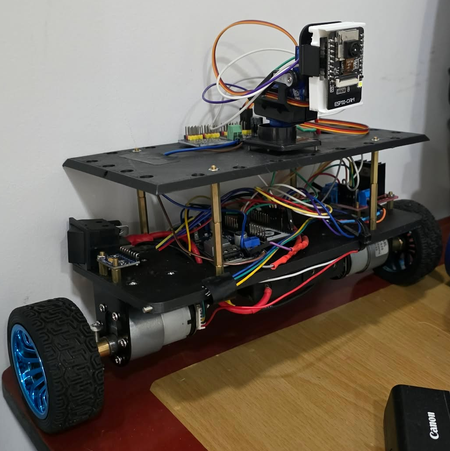
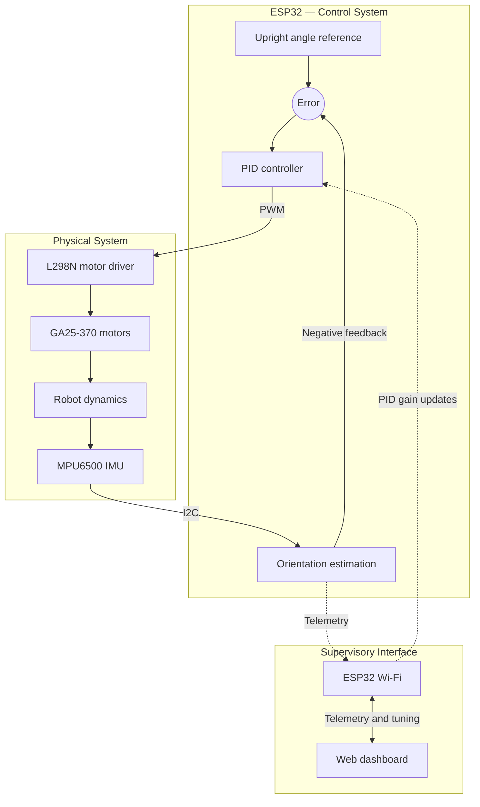

# ESP32-Based Self-Balancing Robot

<p align="center">
  <strong>Robotics · Embedded Systems · Feedback Control</strong>
</p>

<p align="center">
  
  
  
  
  
</p>

<!-- Replace the placeholder URL below with assets/images/robot-hero.jpg after uploading your photograph. -->
<p align="center">
  
  <br>
  <em>Figure 1. ESP32-based self-balancing robot prototype.</em>
</p>

<p align="center"><em>Two-wheeled robotic platform for real-time orientation estimation and closed-loop stabilization.</em></p>

<p align="center">
  <a href="#demonstration">Demonstration</a> ·
  <a href="#system-architecture">Architecture</a> ·
  <a href="#hardware">Hardware</a> ·
  <a href="#getting-started">Getting Started</a> ·
  <a href="#testing-and-validation">Testing</a>
</p>

---

## Project Overview

This project develops a two-wheeled self-balancing robot based on the ESP32 microcontroller. An MPU6500 inertial measurement unit (IMU) provides accelerometer and gyroscope measurements for estimating the robot's tilt. A proportional–integral–derivative (PID) controller calculates corrective motor commands, which are applied through a dual H-bridge motor driver. An ESP32-hosted web dashboard supports wireless monitoring and controller tuning during development.

## Demonstration

### Robot operation

<p align="center">
  <a href="https://www.youtube.com/shorts/msnDinaH7lM">
    
  </a>
  <br>
  <em>Click the image to watch the demonstration.</em>
</p>


## Key Features

- ESP32-based embedded control using Arduino C/C++.
- Six-axis accelerometer and gyroscope measurements from the MPU6500.
- Closed-loop PID stabilization with bidirectional PWM motor control.
- ESP32 Wi-Fi access point and browser-based monitoring interface.
- Adjustable PID gains through the web dashboard.

## System Architecture




## Hardware

### Bill of materials

| Component | Specification | Quantity | Function |
|---|---|---:|---|
| Microcontroller | ESP32-WROOM-32 development board, 38-pin | 1 | Embedded processing and wireless communication |
| IMU | MPU6500 | 1 | Angular velocity and acceleration sensing |
| Motor driver | L298N dual H-bridge module | 1 | Bidirectional motor actuation |
| Geared DC motor | GA25-370 | 2 | Wheel actuation |
| Wheels | Compatible with motor shaft | 2 | Ground contact |
| Chassis | Prototype frame | 1 | Mechanical support |
| Power supply | To be documented | 1 | Motor and logic power |

<!-- TODO: Add motor voltage, gear ratio, rated speed, stall current, wheel diameter, battery chemistry/voltage, robot mass and dimensions when measured. -->

### Pin assignment

The following is the working pin map carried forward from the earlier development configuration. Verify it against the final sketch and physical wiring before connecting power.

| Device | Signal | ESP32 GPIO | Function |
|---|---|---:|---|
| MPU6500 | SDA | 21 | I²C data |
| MPU6500 | SCL | 22 | I²C clock |
| L298N | ENA | 25 | Motor A PWM enable |
| L298N | IN1 | 26 | Motor A direction |
| L298N | IN2 | 27 | Motor A direction |
| L298N | IN3 | 32 | Motor B direction |
| L298N | IN4 | 33 | Motor B direction |
| L298N | ENB | 14 | Motor B PWM enable |


## Control System

### Orientation estimation

The accelerometer provides a gravity-based tilt estimate, while the gyroscope measures angular velocity. Accelerometer measurements can be affected by linear acceleration and vibration; integrating gyroscope measurements introduces drift. Combining these signals can improve the tilt estimate.

For a complementary-filter implementation, the representative discrete-time equation is:

$$
\hat{\theta}_k = \alpha(\hat{\theta}_{k-1} + \omega_k\Delta t) + (1-\alpha)\theta_{\mathrm{acc},k}
$$

where $\hat{\theta}$ is the estimated tilt, $\omega$ is the bias-corrected angular velocity about the balancing axis, $\Delta t$ is the sampling interval, and $\alpha$ is the filter coefficient.

The balancing axis, sign convention and filter coefficient must be matched to the actual IMU mounting and firmware. This equation documents a representative approach, not a verified transcription of the current sketch.

### PID controller

The controller minimizes the difference between the target and estimated tilt:

$$
e(t)=\theta_{\mathrm{ref}}-\hat{\theta}(t)
$$

$$
u(t)=K_p e(t)+K_i\int_0^t e(\tau)\,d\tau+K_d\frac{de(t)}{dt}
$$

The signed control output is mapped to motor direction and PWM magnitude, subject to the configured output limit. Motor polarity must be verified so that the wheels move to counter the robot's fall.

| Parameter | Previous development setting | Purpose |
|---|---:|---|
| $K_p$ | 25 | Proportional correction |
| $K_i$ | 0 | Accumulated error correction |
| $K_d$ | 0.5 | Damping through error-rate feedback |
| PWM limit | 120 | Limit on motor command magnitude |
| Control frequency | 100 Hz | Target loop update rate |
| Calibration samples | 300 | Stationary IMU calibration |

These are historical development settings, not validated optimal gains. Their effective units and PWM scale depend on the final implementation. Confirm values against the current firmware before use.


## Web Dashboard

<p align="center">
  
</p>

<!-- Replace the placeholder with assets/images/dashboard.png. -->

The embedded web interface is intended to display orientation readings and provide adjustment of PID gains during development.

| Network parameter | Previous configuration |
|---|---|
| Wi-Fi mode | Access point |
| SSID | `ESP32_BALANCE` |
| Development password | `12345678` |
| Dashboard address | `http://192.168.4.1` |

Confirm the network settings in the actual sketch. Change the default password before use in shared environments. The dashboard should not be treated as a safety-critical emergency-stop interface.


## Getting Started

### Prerequisites

- Arduino IDE 2.x or another compatible ESP32 development environment.
- Espressif ESP32 Arduino board package.
- USB data cable and appropriate USB-to-serial driver, if required by the development board.
- Any additional IMU or networking libraries imported by the final sketch.

### Installation

### Installation

1. Install [Arduino IDE](https://www.arduino.cc/en/software) and the ESP32 board package by Espressif Systems.

2. Clone or download this repository:

   ```bash
   git clone https://github.com/ChuongHKNguyen/esp32-self-balancing-robot.git
   ```

3. Copy the files from `software/` into a folder named `balance_turn`:

   ```text
   balance_turn/
   ├── balance_turn.ino
   ├── Fuzzy_pid.h
   └── web_ui_balance_turn.h
   ```

4. Open `balance_turn.ino` in Arduino IDE.
5. Select **ESP32 Dev Module** and the corresponding COM port.
6. Install any required library dependencies, compile and upload the firmware.
7. Open the Serial Monitor to verify initialization.

### Initial operation and tuning

1. Secure the robot in a test stand with the wheels clear of the ground and keep a physical power disconnect within reach.
2. Keep the robot stationary in the intended calibration orientation during startup.
3. Verify that the displayed tilt and gyro readings respond correctly to manual movement.
4. With limited motor output, check that both motors respond in the direction required to counter a fall.
5. Tune proportional gain gradually, then derivative gain to improve damping. Introduce integral action only if necessary and with appropriate anti-windup protection.
6. Verify motor cutoff behavior, sensor fault response and output limits before attempting free-standing balance.
7. Perform controlled balancing trials in a clear area with a suitable support or restraint.

## References

- [Arduino ESP32 documentation — Espressif](https://docs.espressif.com/projects/arduino-esp32/en/latest/)
- [Arduino documentation](https://docs.arduino.cc/)
- [L298 dual full-bridge driver — STMicroelectronics](https://www.st.com/en/motor-drivers/l298.html)
- [Inverted Pendulum: System Modeling — University of Michigan, Control Tutorials for MATLAB and Simulink](https://ctms.engin.umich.edu/CTMS/index.php?example=InvertedPendulum&section=SystemModeling)

<!-- Add the exact MPU6500 breakout and GA25-370 variant datasheets, and any libraries or algorithms used in the actual implementation. Credit third-party code and assets where applicable. -->

## Author

**YOUR_NAME**  
Robotics and Mechatronics Engineering

<!-- Replace the placeholders and remove any links you do not want to publish. -->
[GitHub](https://github.com/YOUR_GITHUB_USERNAME) · [LinkedIn](https://www.linkedin.com/in/YOUR_LINKEDIN_ID/) · [YouTube](https://www.youtube.com/@YOUR_CHANNEL)

## License

A project license has not yet been selected. Add the appropriate `LICENSE` file before granting reuse permissions. Third-party dependencies remain subject to their respective licenses.

---

<p align="center"><sub>Designed and developed as a hands-on investigation of embedded robotic stabilization.</sub></p>
